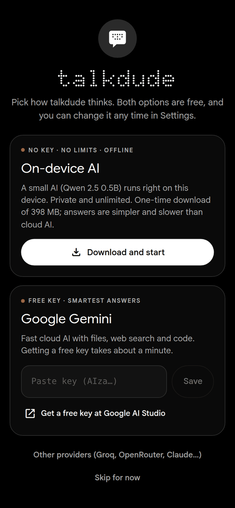
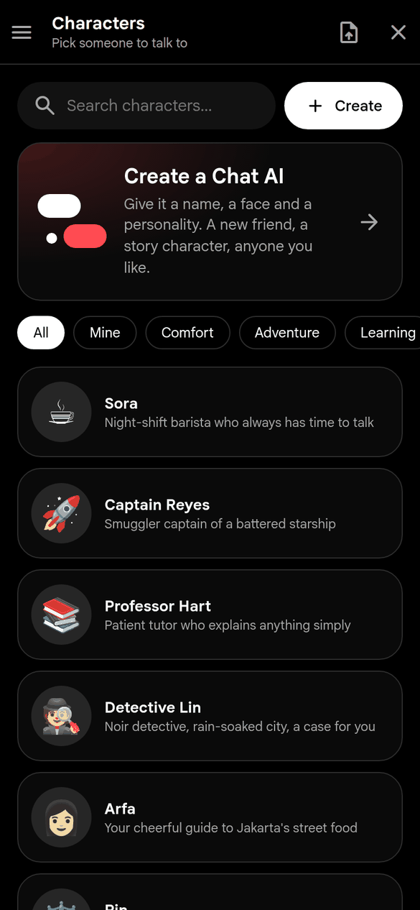
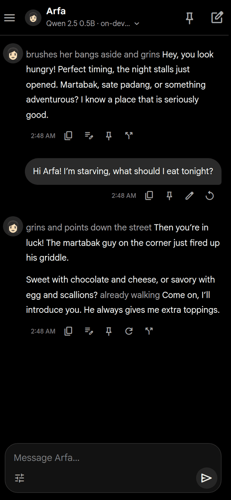
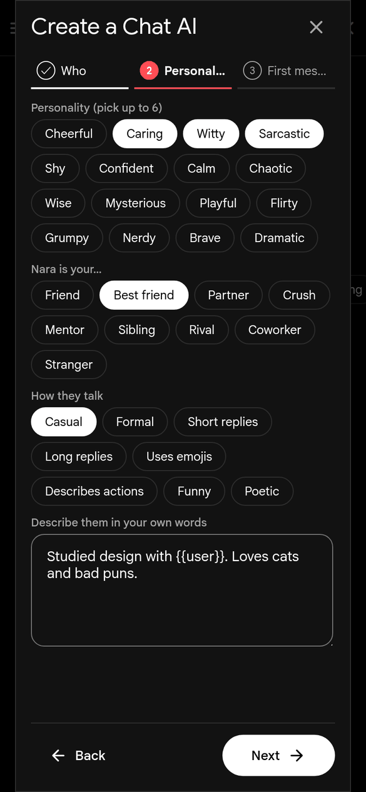
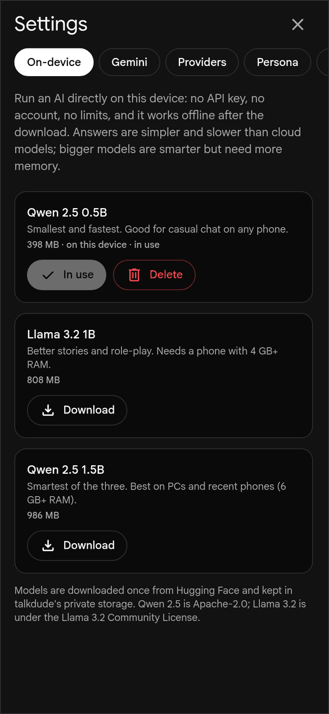

<p align="center">
  
</p>

<h1 align="center">talkdude</h1>

<p align="center">
  A free, private AI chat companion for Android, Windows and Linux.<br/>
  No account. No chat limits. Works offline.
</p>

<p align="center">
  <a href="https://apps.obtainium.imranr.dev/redirect?r=obtainium://app/%7B%22id%22%3A%22io.github.ariastiadi.talkdude%22%2C%22url%22%3A%22https%3A%2F%2Fgithub.com%2FAriastiadi%2Ftalkdude%22%2C%22author%22%3A%22Ariastiadi%22%2C%22name%22%3A%22talkdude%22%7D"></a>
</p>

---

> **New in 1.5.1:** a new Nothing-style logo, and a Windows version that installs even with Smart App Control on (see below).
>
> **New in 1.5: the built-in AI can see pictures.** Newer, smarter on-device models (Qwen 3.5), longer memory on phones, “Think” mode and a Run button for code with every AI, a Mac version, and many fixes. In 1.4: “save to memory”, plus files, links and web search with any AI. In 1.1: chat without any API key. talkdude can now download a small AI model once and run it right on your phone or PC. No key, no sign-up, no limits, and it keeps working without internet.

<p align="center">
  
  
  
  
  
</p>

## What it does

talkdude is a chat app for talking with AI: ask questions, write, brainstorm, or role-play with characters in the style of Chai and Character.AI. Pick how it thinks on the first launch:

- **On-device AI:** a small open model (Qwen 3.5, Qwen 2.5 or Llama 3.2) runs inside the app. Free, unlimited, private and offline. Qwen 3.5 can also look at pictures.
- **Cloud AI with your own free key:** Google Gemini, Groq, OpenRouter's free models, or paid providers like OpenAI and Claude.

Your chats are stored only on your device. talkdude has no server of its own.

## Features

- **Works with no key at all.** Download a model once, then chat as much as you like, even in airplane mode: Qwen 3.5 0.8B (580 MB), 2B (1.4 GB) or 4B (3 GB), Qwen 2.5 0.5B / 1.5B, or Llama 3.2 1B. Settings → On-device marks the one that suits your device. Downloads that get cut off continue where they stopped.
- **The built-in AI can see.** Add “eyes” to a Qwen 3.5 model (one extra download) and attach a photo: it describes it, reads it and answers questions about it, fully offline.
- **Smarter with long files.** For on-device models, talkdude picks the parts of a long document that match your question instead of only reading the first page.
- **Small.** The Android APK is about 8 MB, with a fast native llama.cpp engine built in; models are downloaded only if you use them.
- **Memory, like ChatGPT, Gemini and Claude.** talkdude notes what you tell it about yourself (name, interests, plans, how you like answers), and you can say it out loud too: *“save to memory: I live in Bandung”*, *“ingat ya, aku suka kopi”*, *“forget that”*, or just ask the AI in your own words to keep something in mind. Every save shows an **Undo** button. Notes are matched by topic too (coffee ↔ favourite drink), and the relevant ones go to the AI in every chat, so even the built-in AI gets more personal over time. No limit on notes. See, search, edit or delete everything in Settings → Memory.
- **Files, links and web search for every AI.** Attach pictures, PDF, Word (.docx), text and code files to any model, including the on-device one. If a model can't see pictures, the picture is left out with a note instead of an error. Switch on **Web search** or **Read links** in the Tools menu and talkdude looks things up itself (DuckDuckGo, DuckDuckGo Lite, then Wikipedia as backups) and hands the results to the AI. No key needed.
- **Think mode and Run for every AI.** Tap **Fast/Think** to let any model reason step by step first (shown in a Thinking box). JavaScript and Python code in replies gets a **Run** button; code runs on your device (Python loads once, about 10 MB).
- **Many providers in one model picker.** Gemini and Gemma, Claude, OpenAI, Groq, OpenRouter, DeepSeek, Mistral, Ollama, or any OpenAI-compatible server.
- **No chat limits.** talkdude never counts your messages. When a cloud model hits its free-tier limit, the reply continues on the next model you've set up.
- **Create a Chat AI.** Make your own AI in three steps: a name and photo (or emoji), a personality (pick traits like witty or caring, what they are to you, how they talk, plus your own description) and a first message.
- **Everything is editable.** Change any character's name, photo, personality, greeting and more, including the built-in ones (Sora, Captain Reyes, Arfa, Detective Lin…), and reset them to the original any time. Import or export **Character Card V2** files (JSON or PNG, as used by SillyTavern and Chub).
- **Role-play tools.** Swipe between alternative replies (`< 2/3 >`), edit any AI reply to steer the story, and pin up to 15 memories per chat so the AI never forgets them. Your persona fills in `{{user}}`.
- **Optional content filter.** Gemini's safety filters can be switched off in Settings for adults. Each provider's own policies still apply.
- **Export and backup.** Export a chat to Markdown, back up every chat and character to one JSON file, and restore it any time. API keys are never written to backups.
- **Gemini extras.** Google's own file uploads, Google Search, server-side code execution and adjustable thinking levels.
- **Nothing-inspired look.** Black and white, a single red dot, dot-matrix headings. Dark, light or follow the system.

## Privacy

- Conversations, characters and settings are stored locally (IndexedDB). There is no talkdude account or server.
- On-device models run entirely on your device. After the one-time download (engine from the jsDelivr npm CDN, checked against a built-in SHA-256 hash; model from Hugging Face), nothing you type leaves the device.
- When you use a cloud provider, your messages go straight from the app to that provider with your own key, under that provider's privacy policy.
- Web search and Read links are off until you switch them on. When on, the words you search for are sent to DuckDuckGo (or Wikipedia) and the pages you link are fetched from their websites. Attached files are read on your device and sent only to the AI you chose.
- No ads, no trackers, no analytics. The code is open for anyone to check.

## Install

### Android

Pick one:

- **Obtainium:** tap the badge above, or add `https://github.com/Ariastiadi/talkdude`. Obtainium keeps the app updated.
- **Komi Store:** [open talkdude in Komi Store](https://github-store.org/app?repo=Ariastiadi/talkdude)
- **Manually:** download `talkdude-android-arm64-v8a.apk` from [Releases](https://github.com/Ariastiadi/talkdude/releases/latest). Most phones need `arm64-v8a`; older 32-bit phones need `armeabi-v7a`.

Updates install over the old version without uninstalling.

### Windows, Mac and Linux

Download from [Releases](https://github.com/Ariastiadi/talkdude/releases/latest):

| Platform | Files |
|----------|-------|
| Windows  | `.exe` installer or `.msi` |
| Windows with Smart App Control | `talkdude-windows-edge-setup.zip`: unzip it and run the setup. It runs talkdude in Microsoft Edge, so Smart App Control doesn't block it, and needs no admin rights. Its built-in AI is slower and can't see pictures. |
| Mac (Apple Silicon) | `talkdude-macos-arm64.dmg`. It isn't signed with an Apple developer ID yet: the first time, right-click the app → **Open**. |
| Linux    | `.AppImage`, `.deb` or `.rpm` |

`talkdude-android-play.aab` is the app bundle for publishing on Google Play. An iPhone version needs an Apple developer account and isn't available yet.

> **Arch/Fedora:** if the AppImage crashes with an EGL display error, use the `.rpm` or convert the `.deb` with `debtap`.

## Getting started

1. Open talkdude and choose **Download and start** for the free on-device AI, or paste a free [Gemini API key](https://aistudio.google.com/app/apikey).
2. Want more models? Open **Settings → Providers → Add provider**, pick a preset (Groq, OpenRouter, Claude, …), paste your key, then **Test connection** and **Save**. For OpenRouter, tap **Fetch model list** with *free models only* ticked.
3. Switch models any time from the model name under the chat title.

**Ollama on your phone:** run Ollama on a PC in the same Wi-Fi network with `OLLAMA_HOST=0.0.0.0`, then use `http://<pc-ip>:11434/v1` as the Base URL.

## Verify the APK

Every Android release is signed with the same key. The SHA-256 fingerprint of the signing certificate is:

```
D4:5F:DB:5A:21:66:FB:3A:D6:0D:0D:3E:70:E6:66:AD:67:49:58:EF:27:D4:4A:81:F9:02:B4:5E:E8:8D:D0:44
```

## Requirements

- Android 7.0 (API 24) or newer. On-device models need roughly 1.5 GB of free RAM for the small ones, 3 GB for Qwen 3.5 2B and 5 GB for Qwen 3.5 4B.
- Windows 10/11, macOS 11+ on Apple Silicon, or a recent 64-bit Linux desktop.

## Build from source

talkdude is built with [Tauri v2](https://v2.tauri.app/) (Rust) and SolidJS. In the app, on-device models run with [llama.cpp](https://github.com/ggml-org/llama.cpp) (including its multimodal library for pictures); in a plain browser with [wllama](https://github.com/ngxson/wllama). You need [Bun](https://bun.sh/) 1.0+, [Rust](https://www.rust-lang.org/) 1.77+ and, for Android, the Android SDK and NDK.

```bash
bun install
bun run tauri icon app-icon.svg   # regenerate app icons
bun run tauri dev                 # development build
bun run tauri build               # desktop release build
bun run tauri android build --apk # Android
```

Tests: `bun run typecheck`, `bun run test` (unit tests) and, after `bun run build`, `bun run test:e2e` (the web app with a mocked AI). GitHub Actions runs them and builds every platform on each push to `main` (see `.github/workflows/release.yml`). When the `version` in `src-tauri/tauri.conf.json` has no release yet, a new GitHub Release is published with the APKs, EXE/MSI and AppImage/DEB/RPM.

## License

talkdude is free software under the [GNU General Public License v3.0 or later](LICENSE).

It started as a fork of [Lumi AI](https://github.com/iamlooper/Lumi-AI) by Looper (MIT). The original MIT license text and third-party credits (Doto font, OFL) are in [NOTICE.md](NOTICE.md). On-device model weights are downloaded from Hugging Face and keep their own licenses (Qwen 2.5 and Qwen 3.5: Apache-2.0; Llama 3.2: Llama 3.2 Community License).
